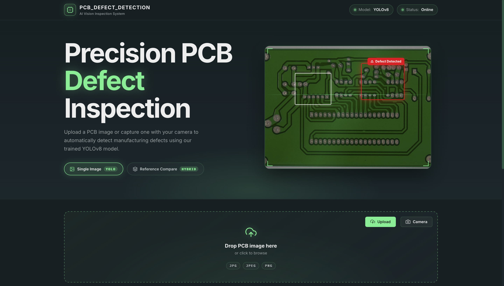
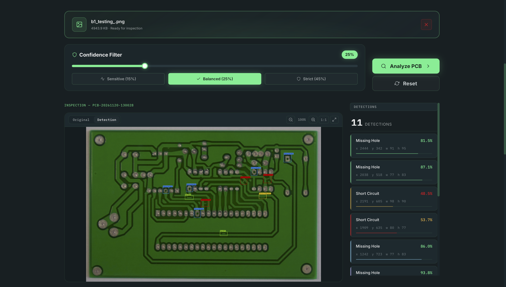

# PCB Defect Detection

AI-powered PCB quality inspection. Upload a board photo (or capture one with the camera) and a fine-tuned YOLOv8n model finds manufacturing defects, draws bounding boxes, and exports an annotated image plus a PDF report. A hybrid mode compares a testing board with a known-good reference to confirm each defect.

## Screenshots

| Home | Detection results |
|---|---|
|  |  |

## What it does

- **Single Image (YOLO)** — upload JPG/JPEG/PNG or use the webcam; adjust confidence with Sensitive / Balanced / Strict presets, then click **Analyze PCB**.
- **Reference Compare (HYBRID)** — upload a known-good board and a testing board; ORB/RANSAC alignment + SSIM difference verify each YOLO detection and return a **PASS / FAIL / REVIEW** verdict.
- Detects six classes: Open Circuit, Short Circuit, Mouse Bite, Spur, Spurious Copper, Missing Hole.
- Shows an annotated image, detection list, confidence scores and summary, with PDF report and image download.

## Tech stack

- **Frontend:** React + Vite, Axios, react-webcam, jsPDF
- **Backend:** FastAPI, Uvicorn, OpenCV, Pillow
- **Model:** Ultralytics YOLOv8n fine-tuned on the PCB Defects dataset (~0.89 mAP50), runs on Apple MPS / CPU

## Author

Rohit Deshmukh · [@Rohitd944](https://github.com/Rohitd944)
